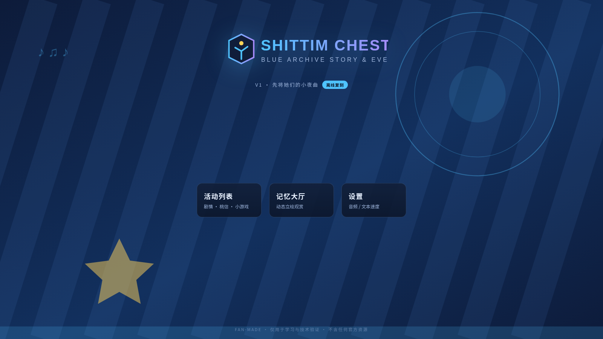
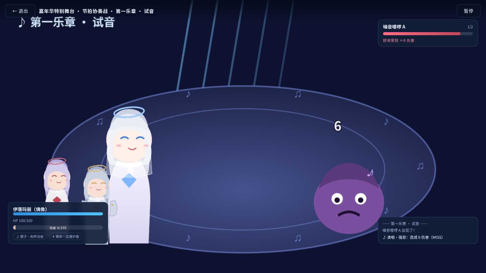
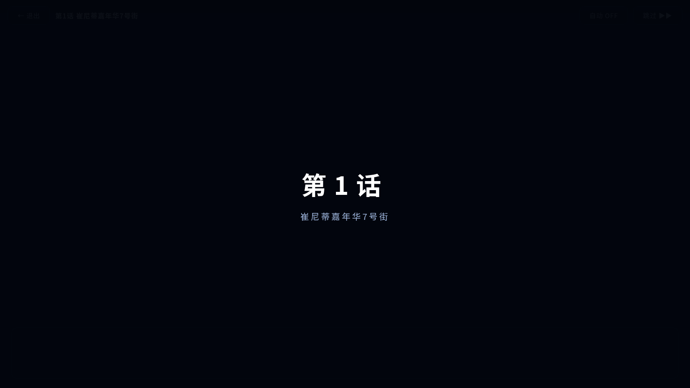
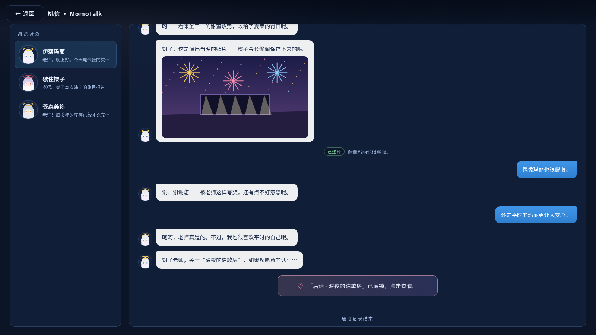

# SHITTIM CHEST · 蔚蓝档案剧情与活动复刻平台

**清单驱动 · 完全离线 · FAN-MADE**

以《蔚蓝档案（Blue Archive）》国际服活动 **「先将她们的小夜曲」（Serenade Promenade）** 为首个复刻目标的剧情/活动复刻平台。V1 打通从引导加载 → 主菜单 → 活动中心 → 剧情播放 / MomoTalk / 记忆大厅 → 小游戏结算的完整闭环。

| 🌐 网页版 | 💻 Windows 桌面版 |
| --- | --- |
| 启用 GitHub Pages 后：<br>`https://chenmoulaile.github.io/shittim-chest/` | [Releases · v1.0.0](https://github.com/chenmoulaile/shittim-chest/releases) 下载 zip，<br>解压双击 `SHITTIM CHEST.exe`，免安装、完全离线 |

## 预览

| 主菜单 | 节拍协奏战 |
| --- | --- |
|  |  |
| **剧情播放（Pixi 立绘）** | **MomoTalk** |
|  |  |

## 功能特性

- **剧情播放器**：PixiJS 立绘入场/退场/表情切换、说话人高光压暗、震屏/闪光/音符粒子特效、打字机文本、选项分支（flag + label 跳转）、章节转场、自动/跳过模式
- **MomoTalk 桃信**：消息流逐条推送、回复选项分支、羁绊剧情入口（通关第 4 话解锁，解锁链校验）
- **记忆大厅**：vue3-pixi 动态立绘、触摸反馈（表情切换 + 语音 + 心形/音符粒子）
- **小游戏「节拍协奏战」**：回合制指令 × 节拍判定（PERFECT/GOOD/MISS + 连击加成 + 充能大招「终乐章」）、支援被动（樱子·和声治愈 / 美祢·应援护盾）、多波次 + BOSS 战、S/A/B/C 结算评级
- **存档系统**：sql.js（SQLite WASM）持久化章节已读 / 羁绊进度 / 小游戏最高分，失败自动降级 localStorage
- **状态合规**：recap 补档活动自动隐藏小游戏入口
- **完全离线**：清单驱动加载本地内容包，运行期 **0 远程请求**（验收含断网拦截测试）

## 还原度说明（重要，请务必阅读）

本项目定位是 **FAN-MADE 的系统与交互复刻框架**，不是官方游戏的替代品：

| 层面 | 状态 |
| --- | --- |
| 系统架构（清单驱动内容包 / 播放器内核 / 小游戏运行时 / 存档） | ✅ 高保真复刻，对齐官方玩法结构与交互形态 |
| 剧情演出表现（立绘/对话框/选项/特效/MomoTalk 流程） | ✅ 结构完整复刻 |
| 玩法机制（节拍判定 / 回合指令 / 评分规则 / 解锁链） | ✅ 按蓝图规格实现 |
| **官方美术素材 / 立绘 / UI 图** | ⚠️ **占位素材**（脚本生成的 SVG），不含任何官方资源 |
| **官方 BGM / 语音 / 音效** | ⚠️ **占位音频**（程序合成 WAV） |
| **官方剧情文本 / 角色台词** | ⚠️ 自写的等长占位文本，非官方文本 |

> **版权边界**：官方素材、文本、音频受版权保护，本项目**不会**内置任何官方资源。内容包（`public/content/packs/`）为标准 JSON + 资源目录结构，**你可以自行替换为自有素材**（如自制立绘、自购音源、自写文本），复刻框架无需改动。这正是「清单驱动」设计的意义。

**结论：交互与系统能否"完美还原"？——能，且经 19 项自动化验收验证；官方内容本身能否"完美还原"？——出于版权原因刻意不还原，需要你以内容包形式提供素材。**

## 技术栈与架构

```
Vue 3 + TypeScript + Pinia + Vite
├── 渲染层   PixiJS v8 + vue3-pixi（剧情立绘 / 大厅 / 小游戏舞台）
├── 叙事内核 Controller（脚本推进/变量/跳转）+ RenderManager（分层渲染/转场/特效）
├── 内容层   ManifestResolver（清单驱动）+ AssetLoader（bundle 预载）
├── 音频层   AudioManager（BGM / SFX / 语音三通道）
├── 存档层   Database（sql.js WASM → localStorage 降级）
└── 小游戏   统一生命周期接口 + 模块注册表（serenade-stage 等）
桌面版   Electron 33（本地 file:// 加载，零远程依赖）
```

## 快速开始

**网页版开发**

```bash
cd shittim-chest
npm install
npm run dev          # http://localhost:5173
npm run build        # 类型检查 + 生产构建
```

**桌面版（Windows）**

从 [Releases](https://github.com/chenmoulaile/shittim-chest/releases) 下载 `SHITTIM-CHEST-1.0.0-win-x64.zip`，解压后运行 `SHITTIM CHEST.exe`。

自行构建桌面版：

```bash
cd shittim-chest
npm run build                    # 先产出 dist
cd ../shittim-chest-desktop
npm install && npm run dist      # 产物在 release/
```

**自动化验收**（19 项浏览器端到端检查）

```bash
cd shittim-chest && npm run build && npm run preview &
node scripts/visual-check.mjs    # 产出截图 + acceptance-report.json
```

## 目录结构

```
├── shittim-chest/            # Web 应用主体
│   ├── src/core/             # manifest / assets / audio / story / minigame / db
│   ├── src/views/            # Boot / MainMenu / ActivityBrowser / StoryPlayer
│   │                         # / Momotalk / MemoryLobby / Minigame
│   ├── src/components/       # LobbyStage（vue3-pixi 记忆大厅舞台）
│   ├── public/content/       # 本地内容包（manifest + packs）
│   └── scripts/              # 素材生成 / 清单校验
├── shittim-chest-desktop/    # Electron 桌面版封装
├── docs/screenshots/         # 18 张验收截图 + acceptance-report.json（19/19 通过）
└── scripts/                  # 仓库级工具（可视化验收 / 图标生成）
```

## 免责声明

本项目为 **FAN-MADE 学习与技术验证项目**，与 Nexon / Yostar / Blue Archive 官方无任何关联。不含、不分发、不链接任何官方素材资源；所有占位素材均为程序生成。若权利方提出异议，将及时处理。
